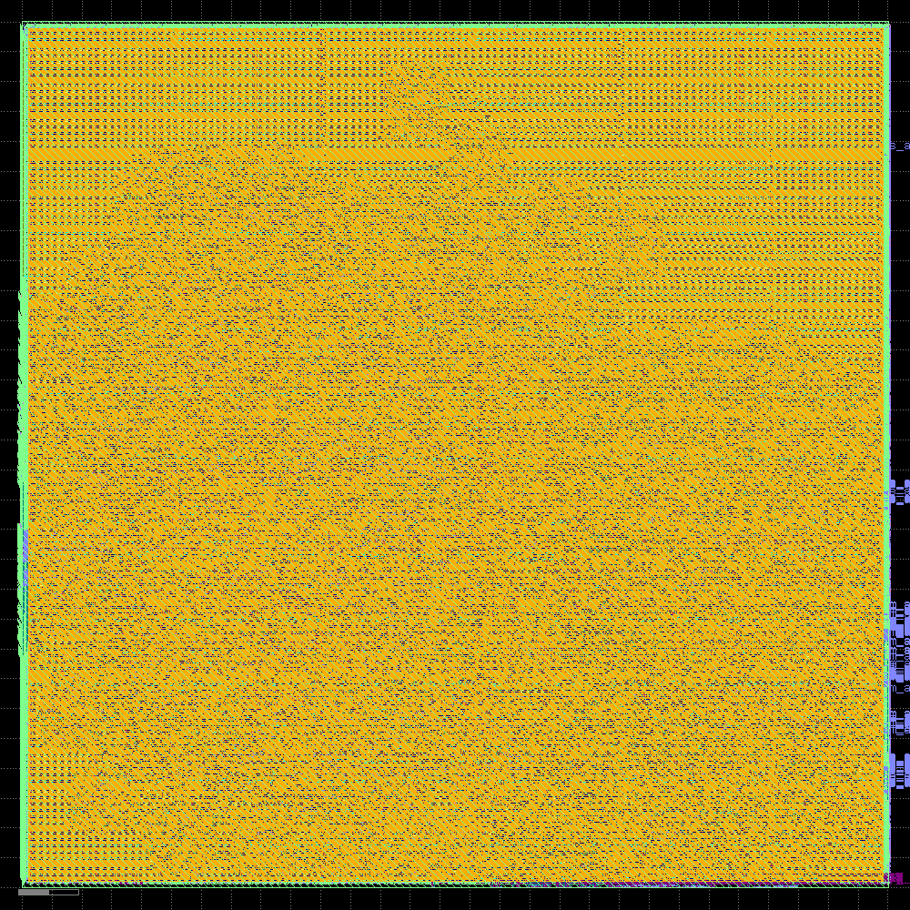
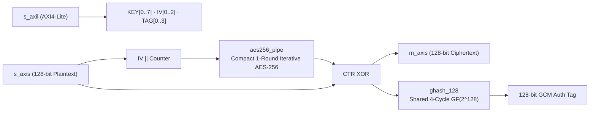

# asap7-aes256-gcm-100g

[[https://github.com/nk-verif-labs/asap7-aes256-gcm-100g/actions/workflows/ci.yml/badge.svg]](https://github.com/nk-verif-labs/asap7-aes256-gcm-100g/actions/workflows/ci.yml)

**1.17 GHz AES-256-GCM (CTR + GHASH) Authenticated Encryption Engine** implemented on **ASAP7 (7 nm FinFET predictive PDK)** via **OpenROAD-flow-scripts** and verified against **NIST FIPS-197 + SP 800-38D** with **Cocotb 1.9.2**.

## Architecture Overview

## Physical Design & Signoff Metrics (`asap7`)

| Metric | Value | Status |
| :--- | :--- | :--- |
| **PDK / Track Library** | `asap7` / `asap7sc7p5t_28_R` (7 nm FinFET) | CONFIGURED |
| **Target Clock / Achieved** | `1000 ps` (`1.0 GHz`) / **`854.25 ps` (`1.171 GHz`)** | CLOSED |
| **Setup Slack** | **`+100.79 ps`** | PASS |
| **Design / Core Area** | `6,157 µm²` active / `20,439 µm²` core (`30%` util) | HARDENED |
| **Total Power / VDD IR Drop** | `15.5 mW` @ `0.77 V` / `2.18 mV` (`0.28%`) | PASS |
| **Antenna Violations** | `0` nets / `0` pins | PASS |
| **Logic Equivalence (LEC)** | Post-CTS & Post-Route | PASS |
| **Cocotb 1.9.2 (Icarus & Verilator)** | NIST FIPS-197 + SP 800-38D Tag | PASS |

## Release Roadmap

| Version | Target Date | Scope | Status |
| :--- | :--- | :--- | :--- |
| `v1.0.0` | Nov 21, 2026 | Compact AES-256-GCM RTL, NIST Cocotb, ASAP7 7 nm GDSII @ `1.17 GHz` | RELEASED |
| `v1.1.0` | Nov 28, 2026 | Multi-$V_T$ PPA tuning + post-route Gate-Level Sim (GLS) in CI | PLANNED |
